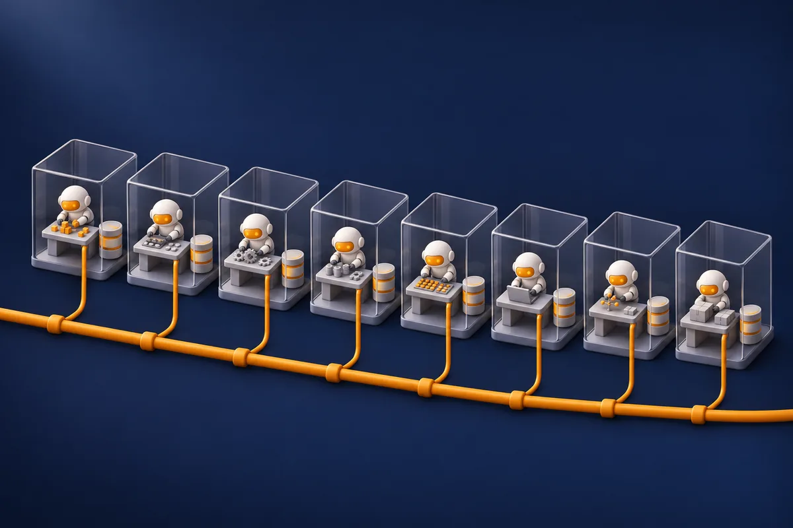
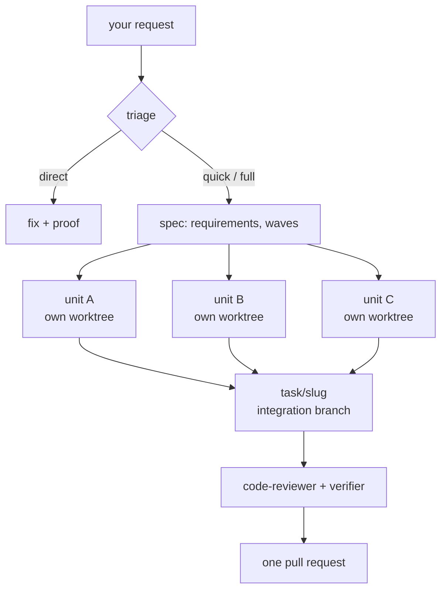
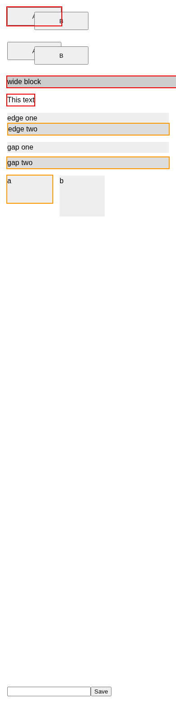
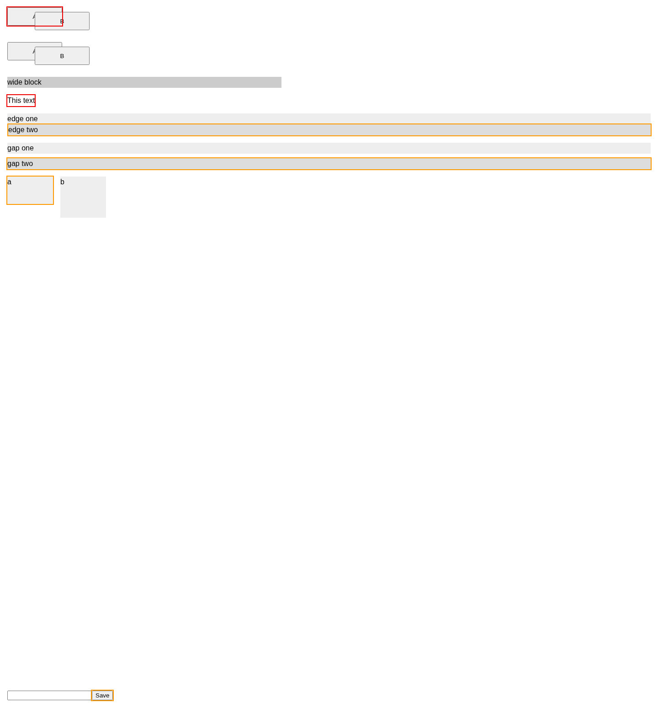
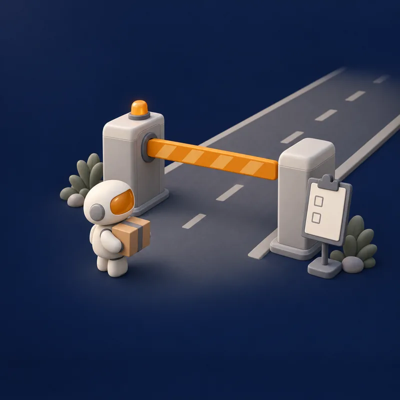
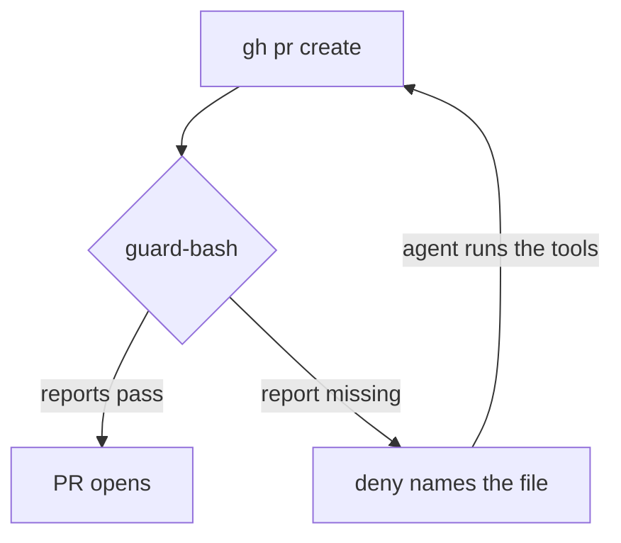

**English** | [Русский](README.ru.md)

<h1 align="center">maxforge-claude</h1>

<h3 align="center">Claude Code for big tasks and whole projects: a plan first, parallel agents, proof before every pull request.</h3>

<p align="center">For developers who hand Claude Code more than one prompt of work: a multi-day feature, a redesign, a new project. A spec first, then parallel subagents in their own worktrees, a verifier that tries to refute the result and one pull request; hooks deny the shortcuts. gsd-core, ECC and spec-kit cover parts of this path; here it is one chain (<a href="#compared-with-what-you-might-already-use">compare</a>). Costs about 1.49 times the tokens (<a href="#cost-and-limits">why</a>).</p>

<p align="center"><a href="#install"><b>Install: three commands in Claude Code</b></a><br><a href="https://sanctusmorte.github.io/maxforge-claude/">Documentation site</a></p>

<p align="center"></p>

<p align="center"><em>One full task: units built in parallel, each in its own worktree, checked at the gate, merged as one pull request. Illustrations: GenAPI. Every output quoted below is real.</em></p>

## Install

**Install the plugin (3 commands in Claude Code)**

```text
/plugin marketplace add sanctusmorte/maxforge-claude
/plugin install maxforge-claude@maxforge-claude
/maxforge-claude:setup
```

`setup` shows a dry run first, then copies the rules to `~/.claude/rules/maxforge/` (old copy backed up) and runs `maxforge doctor`. Start a new session afterwards so the rules load.

> [!NOTE]
> It spends more tokens, not fewer: about 1.49 times the tokens of plain Claude Code at equal quality (author's A/B run, 2026-10-13). Not for single-prompt fixes: plain Claude Code is enough there. The plugin never edits your `CLAUDE.md`. To remove it, see the [FAQ](#faq).

<details>
<summary>Requirements and setup flags</summary>

Requirements: Python 3.10+ and git. Optional: `gh` for the PR flow, Node 18+ and Playwright for the UI tools (`/maxforge-claude:setup --node`).

`/maxforge-claude:setup --settings` merges recommended settings into your `settings.json` without overwriting your values; `--node` installs Playwright for the UI tools.

Check it: `/maxforge-claude:setup` ends with `maxforge doctor`, which reports Python, git, `gh`, Node and the rules copy. Run it again any time by asking Claude to run `maxforge doctor`.

</details>

## One big task, start to finish

<p align="center"></p>

Type `/maxforge-claude:task` and the request. What happens next is written in [`skills/task/SKILL.md`](skills/task/SKILL.md) and [`skills/spec/SKILL.md`](skills/spec/SKILL.md):

1. **Triage.** The request is sized: direct (a one-sentence diff, no spec file), quick (one session, one PR) or full (several sessions or agents). A new repository goes to `/maxforge-claude:project-new` instead.
2. **Spec.** `spec` reads the repository, asks at most 5 decisive questions and writes requirements with acceptance checks, waves and a verification plan. A token budget sits in its header; `hooks/ctx-monitor.py` prints a line at every 10 % of it.
3. **Split by file ownership.** Each unit owns its files. `tools/ownership-check.py` exits 1 when two units of one wave own the same file.
4. **Parallel waves.** One subagent per unit, all independent units at once, each in its own worktree and branch made by `tools/wt-new.sh` (in Laravel repos also its own test database). A dependent unit starts as soon as its dependency is pushed. Claude Code's own cap is `CLAUDE_CODE_MAX_CONCURRENT_SUBAGENTS`; `settings/recommended.json` sets it to 10.
5. **Integration branch.** Unit pull requests merge into `task/<slug>`, and the full local gate runs there.
6. **Review and verify.** One `code-reviewer` on the integrated diff, plus `security-reviewer` when it touches auth, uploads, billing, webhooks or secrets. Then `verifier`, which did not write the code, tries to refute it: `PASSED`, `GAPS_FOUND`, `HUMAN_NEEDED` or `NOT_VERIFIED`.
7. **One pull request** into your base branch. Merging to `main` stays your decision.



The plan block a full task writes before any code (fields from `skills/task/SKILL.md`, laid out to fit a phone):

```text
wave 1:
  <sub-a> backend
    owns app/X/**
    owns tests/Feature/X*
  <sub-b> frontend
    owns resources/js/x/**
wave 2:
  <sub-c> depends on sub-a
integration: task/<slug>-<date>
review: code-reviewer + verifier
  (+ security-reviewer: trigger)
e2e: <runner | NOT_VERIFIED>
```

## A whole project

<p align="center"></p>

`/maxforge-claude:project-new` ([`skills/project-new/SKILL.md`](skills/project-new/SKILL.md)) starts a new repository or service:

1. **Intake and research:** problem, user, constraints; competitors read on the day.
2. **Meaning first:** if it sells, positioning and copy through `/maxforge-claude:site` before any stack work.
3. **Constitution:** `PROJECT.md` and an ADR per stack, hosting, data, auth and deploy choice; a reviewer tries to refute them before bootstrap.
4. **Bootstrap in one pull request:** `dev` branch, CI gate, a test stand and an end-to-end smoke test from day one.
5. **Milestones to tasks:** each milestone becomes tasks, and each task runs the big-task path above.

The project's memory lives in the repository, not in a chat: `docs/project/` holds `PROJECT.md` (yours), `STATE.md` (generated from git and GitHub by `hooks/project-sync.py`), `DECISIONS.md`, `MILESTONES.md` and `specs/`. At session start the same hook prints a digest of the state and the active tasks.

## Long sessions without losing the thread

<p align="center"></p>

- Each task keeps one `progress.md`: goal, branch and PR, next step, dead ends, the command that verifies it. Before compaction `hooks/precompact-handoff.py` refreshes and commits it; after compaction or resume `hooks/session-restore.py` puts it back into context. Test: `tools/test-continuity.py`.
- A subagent that reaches its context fence writes a handoff and returns `FENCE-HANDOFF <path>`; the caller continues with a fresh agent of the same type. `hooks/token-guard.py`.
- The agent's first stop with uncommitted or unpushed work in its task worktree is blocked once per worktree per day, until it commits, pushes or records a handoff. `hooks/stop-guard.py`.

## Proof before "done"

<p align="center"></p>

- **A verifier that tries to refute.** `agents/verifier.md` gets the diff, the requirement list and the draft report, never the code's author, and answers `PASSED`, `GAPS_FOUND`, `HUMAN_NEEDED` or `NOT_VERIFIED` with evidence.
- **No "done" over open requirements.** When the spec still has requirements that are not verified, the agent's stop is blocked once per session with the list (`hooks/stop-guard.py`, `tools/test-continuity.py`).
- **Bugs start with an artefact.** A failing test, a screenshot or a request that shows the bug comes before the fix, and the same artefact passes after it (`rules/task-lifecycle.md`).

### Web UI: a script clicks every control before the pull request

<p align="center">
  <picture>
    <source media="(max-width: 600px) and (prefers-color-scheme: dark)" srcset="docs/public/readme/hero-narrow-dark.svg">
    <source media="(max-width: 600px)" srcset="docs/public/readme/hero-narrow-light.svg">
    <source media="(prefers-color-scheme: dark)" srcset="docs/public/readme/hero-dark.svg">
    
  </picture>
</p>

<p align="center">The agent tries to open a pull request; a script clicked all 6 controls, one did nothing, one threw, so the PR is denied. («Удалить всё» = "Delete all", skipped as destructive.) Real outputs: <a href="evidence/ui/dead-clicks-fixture/report.md">report</a>, <a href="evidence/d4-design-gate-fixture-dead-button.txt">deny</a>.</p>

When a pull request touches UI files, `hooks/guard-bash.py` checks the scorecard next to it. A `PASS` verdict alone is not enough: it needs `dead-clicks/report.json`, where every control has an effect, and `geometry/report.json` with 0 errors. Here the agent tried to open the PR while the self-test fixture's Dead button did nothing and its Throwing button threw; the [deny](evidence/d4-design-gate-fixture-dead-button.txt) names both controls and the missing reports.

Two scripts make those reports:

- `tools/dead-clicks.mjs` clicks every control on each route and viewport and records what changed: a navigation, a request, an overlay, an ARIA or DOM change. Nothing changed means `NO_EFFECT`; a page error means `ERROR`. Both block. Controls labelled as destructive are skipped unless you pass `--include-destructive`.
- `tools/ui-geometry.mjs` loads each page at 390, 768, 1440 and 2560 px and reports overlap, clipped text, horizontal overflow and off-screen controls, with a text-stress mode.

Dead-click report on the self-test fixture (6 controls, 2 blockers, [`report.md`](evidence/ui/dead-clicks-fixture/report.md)):

- **ERROR**: Throwing button, `pageerror: boom`
- **NO_EFFECT**: Dead button, `no url/request/overlay/aria/DOM change`
- **SKIPPED**: Удалить всё, `destructive by text/aria`
- **NAVIGATED**: Go to page two, `index.html -> page2.html`
- **STATE_CHANGED**: Toggle, `aria/checked changed`
- **OVERLAY**: Open dialog, `overlays 0 -> 1`

<details>
<summary><b>Geometry report on the fixture page: 7 errors, 7 warnings</b></summary>

<p>


</p>

Four of the errors, quoted from [`geometry-bad/report.json`](evidence/ui/geometry-bad/report.json):

```text
overlaps #overlap > button:nth-child(2) by 60x30px
page scrolls horizontally: scrollWidth 616 > 390
scroll 132x24 > box 60x24: "This text is clipped"
x -80..-20 vs viewport 0..390
```

</details>

<details>
<summary><b>The other two design-gate denies (no dead-click report, no geometry report)</b></summary>

[`d1-design-gate-no-dead-clicks.txt`](evidence/d1-design-gate-no-dead-clicks.txt):

```text
guard-bash: design gate: a PASS scorecard exists but is not complete — dashboard/scorecard.md: no dead-clicks/report.json next to it (node ~/.claude/tools/dead-clicks.mjs --out <slug dir>/dead-clicks); dashboard/scorecard.md: no geometry/report.json next to it (node ~/.claude/tools/ui-geometry.mjs --out <slug dir>/geometry) — every State matrix row needs a screenshot or an 'n/a reason'; every control needs an effect in dead-clicks/report.json (allowlist only with a reason) or the scorecard says 'Interaction: n/a — <reason>'; geometry/report.json (tools/ui-geometry.mjs) with 0 errors or 'Geometry: n/a — <reason>' (templates/project/design-scorecard.md § State matrix, § Interaction, § Geometry)
```

[`d2-design-gate-no-geometry.txt`](evidence/d2-design-gate-no-geometry.txt):

```text
guard-bash: design gate: a PASS scorecard exists but is not complete — dashboard/scorecard.md: no geometry/report.json next to it (node ~/.claude/tools/ui-geometry.mjs --out <slug dir>/geometry) — every State matrix row needs a screenshot or an 'n/a reason'; every control needs an effect in dead-clicks/report.json (allowlist only with a reason) or the scorecard says 'Interaction: n/a — <reason>'; geometry/report.json (tools/ui-geometry.mjs) with 0 errors or 'Geometry: n/a — <reason>' (templates/project/design-scorecard.md § State matrix, § Interaction, § Geometry)
```

</details>

We did not find a dead-click or geometry runner in the six other repositories we read (tree search, 2026-11-26; method in [`parity.md`](evidence/parity.md)). ECC has a Playwright `e2e-runner` agent.

## What it blocks in every repo

<p align="center"></p>

Each line below is a real hook output from this repository. Several of these gates exist in other packs too; here they come together with the task process and the UI gate.

<p align="center">
  <picture>
    <source media="(prefers-color-scheme: dark)" srcset="docs/public/readme/terminal-dark.svg">
    
  </picture>
</p>

- Whole-file reads over the size cap, re-reads, `cat` dumps and long `sleep` waits. `hooks/token-guard.py`, `hooks/dump-nudge.py`, `tools/test-hooks.py`.
- Editing a file before the rule for its stack was read (`rules-gate`), and a stop with unpushed work (`stop-guard`, see [long sessions](#long-sessions-without-losing-the-thread)).

<details>
<summary><b>All 15 captured denies, with the hook file and the test</b></summary>

First clause of each reply, verbatim; the full output and the stdin that reproduces it are in [`evidence/`](evidence/).

| The agent tries | The hook answers | File | Test |
|---|---|---|---|
| `git push origin main` | `guard-bash: direct push to protected branch 'main' — use a PR (core rule 1)` | `hooks/guard-bash.py` | `tools/test-hooks.py` |
| `git push --force origin dev` | `guard-bash: force-push to a protected or unspecified branch is forbidden (git push --force origin dev)` | `hooks/guard-bash.py` | `tools/test-hooks.py` |
| `rm -rf ~` | `guard-bash: rm -rf on '~'` | `hooks/guard-bash.py` | `tools/test-hooks.py` |
| `git commit --no-verify -m wip` | `guard-bash: git commit --no-verify / -n bypasses hooks — forbidden` | `hooks/guard-bash.py` | `tools/test-hooks.py` |
| `php artisan migrate:fresh --force` | `guard-bash: destructive DB command without a test-DB hint (testing/_test/sqlite) — forbidden on dev/prod data` | `hooks/guard-bash.py` | `tools/test-hooks.py` |
| `gh pr create --base main` while `dev` exists | `guard-bash: PR into 'main' while a dev branch exists — base must be dev (core rule 1)` | `hooks/guard-bash.py` | `tools/test-hooks.py` |
| `gh pr create`, UI files changed, PASS scorecard, no reports | `guard-bash: design gate: a PASS scorecard exists but is not complete — dashboard/scorecard.md: no dead-clicks/report.json next to it …` | `hooks/guard-bash.py` | `tools/test-designgate.py` |
| the same, dead-click report but no geometry report | `guard-bash: design gate: … dashboard/scorecard.md: no geometry/report.json next to it …` | `hooks/guard-bash.py` | `tools/test-designgate.py` |
| the same, an Export button with no effect | `guard-bash: design gate: … dead-clicks: 1 control(s) without effect or with an error: NO_EFFECT «Export» …` | `hooks/guard-bash.py` | `tools/test-designgate.py` |
| the same, the self-test fixture's report | `guard-bash: design gate: … dead-clicks: 2 control(s) without effect or with an error: NO_EFFECT «Dead button», ERROR «Throwing button» …` | `hooks/guard-bash.py` | `tools/test-designgate.py` |
| `git commit` with an AWS-style key staged | `secret-scan: possible secrets in added lines:` / `config.py: AWS access key (AKIAIO…PLE)` | `hooks/secret-scan.py` | no dedicated test yet |
| `git commit` with `.env` staged | `secret-scan: secret-bearing file(s) staged: .env — add to .gitignore, commit an .example instead` | `hooks/secret-scan.py` | no dedicated test yet |
| finishing with spec requirements unverified | `stop-guard: 3 REQ not verified in spec.md (REQ-1 export button downloads CSV, REQ-2 empty state shows a message, REQ-3 large file streams) — finish or run verifier before declaring done (shown once).` | `hooks/stop-guard.py` | `tools/test-continuity.py` |
| editing `service.py` before reading the Python rule | ``rules-gate: service.py is covered by python.md which is not in your context …`` | `hooks/rules-gate.py` | `tools/test-hooks.py` |
| `cat big.txt` (3,000 lines) | `dump-nudge: big.txt has >150 lines — a shell dump of it stays in context and skips the stack rules a Read loads. Next: Read big.txt with offset=1 limit=150` | `hooks/dump-nudge.py` | `tools/test-hooks.py` |

</details>

Every gate with its trigger and escape hatch: [Gates](https://sanctusmorte.github.io/maxforge-claude/guide/gates).

## Corrections become checks

<p align="center"></p>

When you correct the agent ("no, not like that", "I said already"), `hooks/lesson-capture.py` flags it; if the session tries to end before `skills/lesson` has recorded what was wrong, what is right, why, and a check that catches it next time, that stop is blocked once. `hooks/subagent-start.py` hands the active lessons and the stack rules to every new subagent, so a worker does not repeat a mistake the main session was already corrected on.

## How it works

Claude Code runs a hook before and after each tool call, at session start, before compaction and when the agent tries to stop. maxforge-claude registers 15 Python scripts on 7 of those events (`hooks/hooks.json`). A `PreToolUse` hook that returns `deny` cancels the call; the agent reads the reason and has to fix the cause. The hooks use the Python standard library only.



One `gh pr create` for a UI change, from the agent's attempt to the open pull request.

- **Before a tool call:** `guard-bash`, `secret-scan`, `dump-nudge`, `rules-gate` and `token-guard` can deny; `bg-router` moves slow builds and installs to the background.
- **Around compaction:** `precompact-handoff` commits the task's `progress.md`; `session-restore` re-injects it after compaction or resume.
- **At stop:** `stop-guard` blocks the first stop while the task worktree has unpushed work or unverified requirements.

<details>
<summary><b>What else is in the box (12 subagents, 17 skills, 9 rules, 44 tools)</b></summary>

| Part | Where | Role |
|---|---|---|
| Hooks (Python 3.10+, stdlib only) | `hooks/*.py` | deterministic gates on tool calls, session start, compaction and stop |
| 17 skills | `skills/*/SKILL.md` | procedures: `/maxforge-claude:task`, `spec`, `qa-verify`, `ui-task`, `site`, `handoff`, `lesson`, ... |
| 12 subagents | `agents/*.md` | one role per file, model and effort pinned: verifier, code-reviewer, security-reviewer, ui-qa, design-judge, ... |
| 9 rules | `rules/*.md` | senior code, task lifecycle, UI design and per-stack rules (Laravel/PHP, Vue/TS, Python) |
| 44 tools | `tools/` | worktree bootstrap, dead-click and UI QA runners, test selection, token reports |
| Output style | `extras/output-styles/dense-en.md` | short answers, verdict first |

</details>

## Cost and limits

- About 1.49 times the tokens of plain Claude Code at equal quality, measured by the author on 2026-10-13 (one measurement; the raw data is not published). The extra goes to review and verifier passes, UI QA runs, handoff files and rule reads.
- Gates match command patterns. A renamed script or an unusual command line can pass.
- Parts of the big-task path are instructions, not denies: no hook forces a subagent into its worktree (gsd-core has one), the 10-agent cap holds only through Claude Code's own setting, the token budget is advisory, and the stop check for unverified requirements blocks once per session.
- Each gate has an escape hatch for one command (`CLAUDE_GUARD_OFF=1`, `CLAUDE_ALLOW_SECRETS=1`, `CLAUDE_TOKEN_GUARD_OFF=1`, `CLAUDE_BG_ROUTER_OFF=1`); the agent is told to name the reason when it uses one.
- `hooks/secret-scan.py` has no dedicated test yet; gitleaks is used when installed.
- Self-tests on 2026-11-26: `python3 -m unittest discover tests` ran 44 tests, OK; `node tools/test-ui-geometry.mjs` passed 17 checks; `python3 tools/test-hooks.py` passed 314 checks, `FAILS: 0` (the author-only `main-sync` suite is skipped: that hook is not shipped). Your CI, code review and tests stay; Linux is the author's platform, macOS has no test matrix, Windows via WSL.

## Compared with what you might already use

Read from each project's README, skills and hook files on 2026-11-26. These projects solve different problems and can sit next to this one.

| Project | How a big task runs, and what a hook denies |
|---|---|
| Hand-written `CLAUDE.md` | **Runs:** the way you describe it<br>**Denies:** nothing: text only |
| [gsd-core](https://github.com/open-gsd/gsd-core) | **Runs:** new project, milestones, phases, waves of subagents<br>**Denies:** a subagent started without worktree isolation; writes outside the worktree |
| [spec-kit](https://github.com/github/spec-kit) | **Runs:** spec, plan, tasks; `[P]` marks parallel tasks; no review step found<br>**Denies:** none found |
| [everything-claude-code](https://github.com/affaan-m/everything-claude-code) | **Runs:** skills `blueprint` and `ralphinho-rfc-pipeline`<br>**Denies:** git hook bypasses, dev servers outside tmux; context gate advisory |
| [claude-code-harness](https://github.com/Chachamaru127/claude-code-harness) | **Runs:** Solo, Parallel or Breezing; workers with `isolation: worktree`; review gate<br>**Denies:** pushes to main, force-pushes, secret reads |
| [Anthropic plugins](https://github.com/anthropics/claude-plugins-official) | **Runs:** `feature-dev`: exploration, architecture and review agents<br>**Denies:** none; `security-guidance` warns |
| [SuperClaude](https://github.com/SuperClaude-Org/SuperClaude_Framework) | **Runs:** not checked<br>**Denies:** none in the README |
| [superpowers](https://github.com/obra/superpowers) | **Runs:** a fresh subagent per task, in sequence; branch review<br>**Denies:** none; one SessionStart hook |
| **maxforge-claude** | **Runs:** spec, split by file ownership, parallel worktrees, `task/<slug>`, reviewer and verifier, one PR<br>**Denies:** push to `main`, PR into `master` while `dev` exists, context fence, UI PR without reports |

**Machine report before a UI pull request.** maxforge requires a dead-click report and a geometry report (`tools/test-designgate.py`). We did not find such a runner in the other repositories we read; ECC has a Playwright `e2e-runner` agent, claude-code-harness gates completion on review ("Serious findings block completion"), gsd-core was not checked.

**What each has that we don't:**

- Hand-written `CLAUDE.md`: written by you for your repo, nothing to install.
- gsd-core: a hook that keeps each subagent inside its own worktree, STATE.md consistency gates, a quick mode. Pick it if hook-enforced isolation matters most to you.
- spec-kit: one spec workflow for many coding agents, community extensions.
- everything-claude-code: breadth (72 agents, 328 skills), a Memory Vault and continuous learning.
- claude-code-harness: a plan / work / review / sync / release flow on a Go guardrail engine.
- Anthropic plugins: `code-review` (parallel agents, confidence scoring) and `hookify` (hooks from your conversations).
- SuperClaude: behaviour modes and optional MCP servers (Serena session memory).
- superpowers: one skills methodology across 16 agent harnesses.

<details>
<summary><b>What each project says about itself (quotes)</b></summary>

- Anthropic on instructions vs hooks: hooks give "deterministic control" where instructions rely "on the LLM to choose" ([hooks guide](https://code.claude.com/docs/en/hooks-guide)).
- gsd-core: "spec-driven development system for Claude Code, OpenCode, … Cursor, Windsurf, and more".
- spec-kit: "Build with a spec, fix a bug, or assess an idea — with your coding agent."
- everything-claude-code: "agent harness operating system"; "Blocks git hook bypasses and dev servers outside tmux (exit 2)"; context gate "advisory by default".
- claude-code-harness: "The AI writes the code. You still manage the work."; denies "direct pushes to the shared main branch, forced pushes", "secret reads".
- Anthropic plugins: "Anthropic's own plugins"; `security-guidance` warns on about 25 patterns and reviews diffs; `frontend-design` is a skill.
- SuperClaude: "Transform Claude Code into a Structured Development Platform"; claims "30-50% fewer tokens".
- superpowers: "complete software development methodology for your coding agents"; skill `verification-before-completion`.

</details>

"Not found" means not found by README read and tree search on 2026-11-26; a gate under another name would not show up. Every link of the maxforge chain exists somewhere else; the whole chain with PR denies was not found. Method, star counts and the capability matrix: [`parity.md`](evidence/parity.md), [`parity-lifecycle.md`](evidence/parity-lifecycle.md).

Try it: [three commands in Claude Code](#install).

## FAQ

<details open><summary><b>Is it only for big projects?</b></summary><p>No. A one-line fix takes the direct path: no spec file, no subagents, the same hooks. The spec, waves and integration branch appear only when triage sizes the task as quick or full.</p></details>

<details><summary><b>Does it save tokens?</b></summary><p>No. It costs about 1.49 times the tokens of plain Claude Code at equal quality (author's A/B, 2026-10-13). The extra goes to review and verifier passes, UI QA runs and handoff files; the raw A/B data is not published.</p></details>

<details><summary><b>Will it change my <code>CLAUDE.md</code> or settings?</b></summary><p>No to <code>CLAUDE.md</code>. Settings change only with <code>--settings</code>; your values are kept and a backup comes first.</p></details>

<details><summary><b>Does it send anything anywhere?</b></summary><p>No telemetry. One hook, <code>project-sync</code>, makes an HTTP GET to the deployed-SHA URLs you list in your own <code>docs/project/PROJECT.md</code>.</p></details>

<details><summary><b>A gate denied something it should not have. Now what?</b></summary><p>Use the escape hatch for that one command (<code>CLAUDE_GUARD_OFF=1</code>, <code>CLAUDE_ALLOW_SECRETS=1</code>, <code>CLAUDE_TOKEN_GUARD_OFF=1</code> or <code>CLAUDE_BG_ROUTER_OFF=1</code>) and open an issue with the deny line. False positives are the feedback this project asks for.</p></details>

<details><summary><b>Do I need Node?</b></summary><p>Only for the UI tools. Without it a UI PR passes the design gate only with a written <code>n/a — &lt;reason&gt;</code> in the scorecard. Changes without UI files are not gated by the UI reports at all.</p></details>

<details><summary><b>macOS? Windows?</b></summary><p>The author runs Linux. macOS should work and has no test matrix; on Windows use WSL.</p></details>

<details><summary><b>How do I remove it?</b></summary><p>Ask Claude to run <code>maxforge uninstall</code> (removes the rules copy, keeps a backup), then <code>/plugin uninstall maxforge-claude@maxforge-claude</code>. Logs in <code>~/.claude/state</code> and <code>~/.claude/logs</code> stay until you delete them.</p></details>

<details><summary><b>Can I use only part of it?</b></summary><p>Yes. Hooks run on their own; skills and agents cost nothing until invoked.</p></details>

## Contribute

Found a false positive or a missing gate? Open an issue with the command and the deny line. Run `python3 -m unittest discover tests` and `python3 tools/test-hooks.py` before a pull request.

## License

MIT, see [`LICENSE`](LICENSE). `skills/laravel-best-practices` is by Laravel (MIT); attribution in [`NOTICE`](NOTICE).
