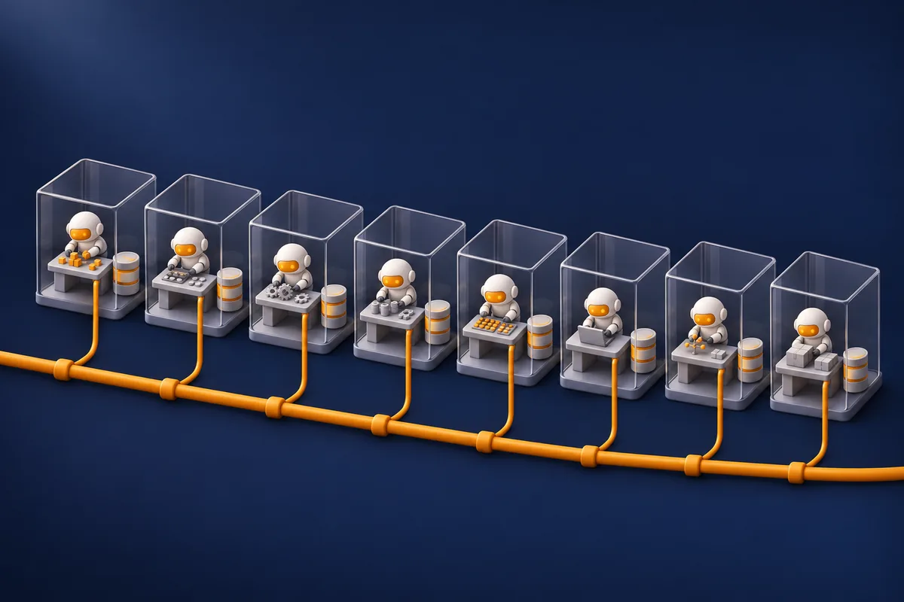
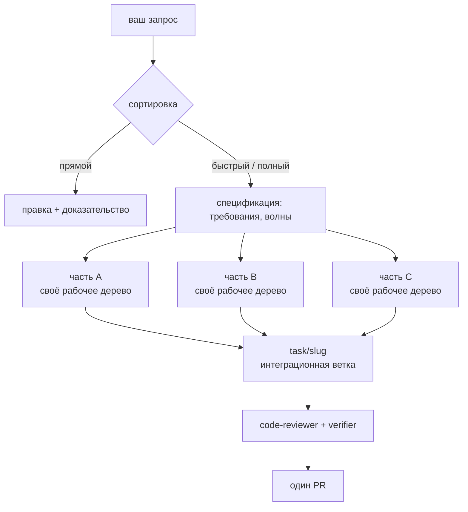
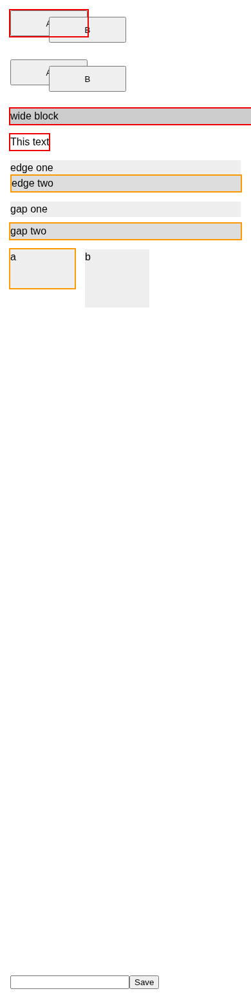
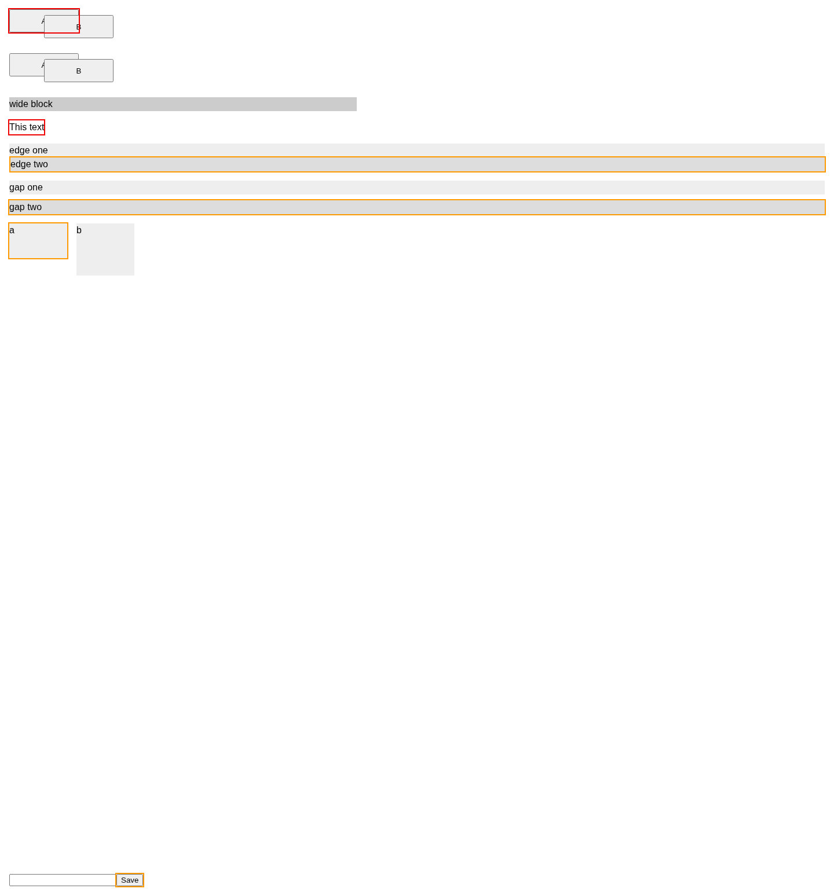
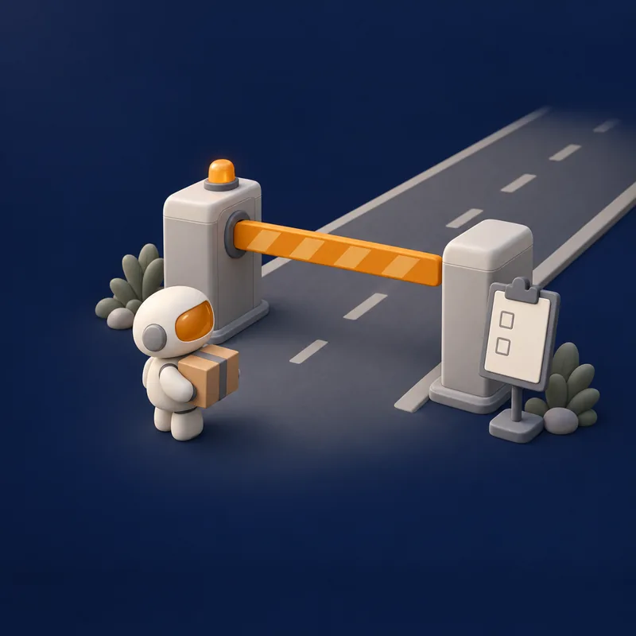
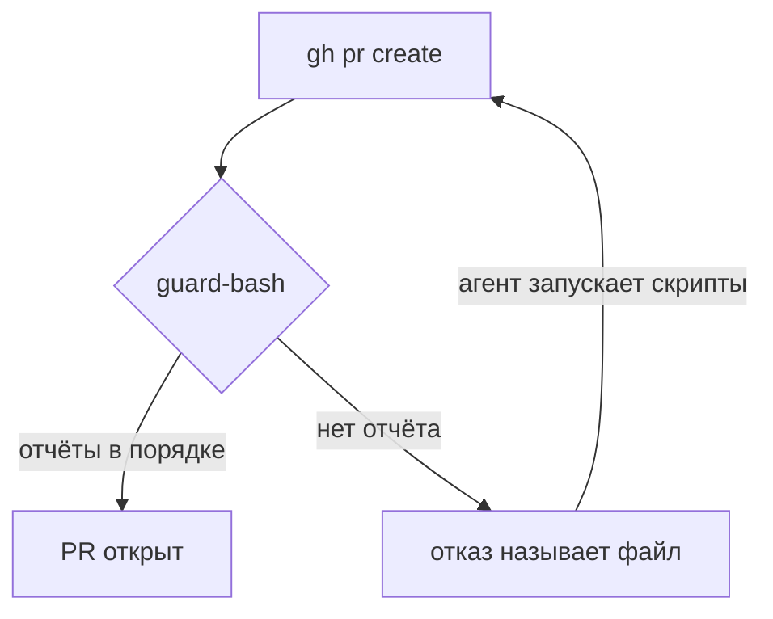

[English](README.md) | **Русский**

<h1 align="center">maxforge-claude</h1>

<h3 align="center">Claude Code для больших задач и целых проектов: сначала план, потом параллельные агенты, доказательства перед каждым PR.</h3>

<p align="center">Для тех, кто отдаёт Claude Code работу больше одного запроса: многодневную функцию, редизайн, новый проект. Сначала спецификация, потом параллельные субагенты в своих рабочих деревьях, проверяющий агент и один PR; хуки отклоняют короткие пути. gsd-core, ECC и spec-kit закрывают части этого пути; здесь это одна цепочка (<a href="#сравнение-с-тем-чем-вы-возможно-уже-пользуетесь">сравнение</a>). Токенов уходит примерно в 1,49 раза больше (<a href="#цена-и-ограничения">почему</a>).</p>

<p align="center"><a href="#установка"><b>Установка: три команды в Claude Code</b></a><br><a href="https://sanctusmorte.github.io/maxforge-claude/ru/">Сайт документации</a></p>

<p align="center"></p>

<p align="center"><em>Одна большая задача: части собираются параллельно, каждая в своём рабочем дереве, проходят проверку и сливаются в один PR. Иллюстрации: GenAPI. Все выводы ниже настоящие.</em></p>

## Установка

**Установить плагин (3 команды в Claude Code)**

```text
/plugin marketplace add sanctusmorte/maxforge-claude
/plugin install maxforge-claude@maxforge-claude
/maxforge-claude:setup
```

`setup` сначала показывает пробный прогон, затем копирует правила в `~/.claude/rules/maxforge/` (старая копия сохраняется) и запускает `maxforge doctor`. После этого откройте новую сессию, чтобы правила подгрузились.

> [!NOTE]
> Токенов уходит больше, а не меньше: примерно в 1,49 раза больше, чем в чистом Claude Code, при равном качестве (A/B-замер автора, 2026-10-13). Не для правок в один запрос: там хватит чистого Claude Code. Плагин не редактирует ваш `CLAUDE.md`. Как удалить: см. [FAQ](#faq).

<details>
<summary>Требования и флаги установки</summary>

Нужны Python 3.10+ и git. По желанию: `gh` для PR, Node 18+ и Playwright для UI-инструментов (`/maxforge-claude:setup --node`).

`/maxforge-claude:setup --settings` добавляет рекомендуемые настройки в ваш `settings.json`, не трогая ваши значения; `--node` ставит Playwright для UI-инструментов.

Проверка: `/maxforge-claude:setup` в конце запускает `maxforge doctor`, который проверяет Python, git, `gh`, Node и копию правил. Повторить можно в любой момент: попросите Claude выполнить `maxforge doctor`.

</details>

## Большая задача от начала до конца

<p align="center"></p>

Наберите `/maxforge-claude:task` и запрос. Дальнейший порядок записан в [`skills/task/SKILL.md`](skills/task/SKILL.md) и [`skills/spec/SKILL.md`](skills/spec/SKILL.md):

1. **Сортировка.** Запрос получает размер: прямой (правка в одно предложение, без файла спецификации), быстрый (одна сессия, один PR) или полный (несколько сессий или агентов). Новый репозиторий идёт в `/maxforge-claude:project-new`.
2. **Спецификация.** `spec` читает репозиторий, задаёт не больше 5 решающих вопросов и пишет требования с критериями приёмки, волны и план проверки. В заголовке стоит бюджет токенов; `hooks/ctx-monitor.py` печатает строку на каждых 10 % бюджета.
3. **Разделение по владению файлами.** Каждая часть владеет своими файлами. `tools/ownership-check.py` завершается с кодом 1, если одним файлом владеют две части одной волны.
4. **Параллельные волны.** Один субагент на часть, все независимые части сразу, у каждой своё рабочее дерево и ветка от `tools/wt-new.sh` (в Laravel-репозиториях ещё и своя тестовая база). Зависимая часть стартует, как только запушена её зависимость. Предел самого Claude Code задаёт `CLAUDE_CODE_MAX_CONCURRENT_SUBAGENTS`; `settings/recommended.json` ставит 10.
5. **Интеграционная ветка.** PR частей сливаются в `task/<slug>`, там запускается полный локальный гейт.
6. **Ревью и проверка.** Один `code-reviewer` на общий дифф, плюс `security-reviewer`, если дифф касается авторизации, загрузок, оплаты, вебхуков или секретов. Затем `verifier`, который не писал этот код, пытается его опровергнуть: `PASSED`, `GAPS_FOUND`, `HUMAN_NEEDED` или `NOT_VERIFIED`.
7. **Один PR** в вашу базовую ветку. Слияние в `main` остаётся вашим решением.



Блок плана, который полная задача пишет до кода (поля из `skills/task/SKILL.md`, разложены под экран телефона):

```text
wave 1:
  <sub-a> backend
    owns app/X/**
    owns tests/Feature/X*
  <sub-b> frontend
    owns resources/js/x/**
wave 2:
  <sub-c> depends on sub-a
integration: task/<slug>-<date>
review: code-reviewer + verifier
  (+ security-reviewer: trigger)
e2e: <runner | NOT_VERIFIED>
```

## Целый проект

<p align="center"></p>

`/maxforge-claude:project-new` ([`skills/project-new/SKILL.md`](skills/project-new/SKILL.md)) запускает новый репозиторий или сервис:

1. **Вводные и исследование:** задача, пользователь, ограничения; конкуренты, прочитанные в тот же день.
2. **Смысл до кода:** если продукт что-то продаёт, позиционирование и тексты через `/maxforge-claude:site` до выбора стека.
3. **Конституция:** `PROJECT.md` и ADR на стек, хостинг, данные, авторизацию и деплой; ревьюер пытается их опровергнуть до старта.
4. **Старт одним PR:** ветка `dev`, гейт CI, тестовый стенд и сквозной smoke-тест с первого дня.
5. **Этапы в задачи:** каждый этап становится задачами, каждая задача идёт путём большой задачи выше.

Память проекта живёт в репозитории, а не в чате: в `docs/project/` лежат `PROJECT.md` (ваш), `STATE.md` (генерирует `hooks/project-sync.py` из git и GitHub), `DECISIONS.md`, `MILESTONES.md` и `specs/`. В начале сессии тот же хук печатает сводку состояния и активных задач.

## Длинные сессии без потери нити

<p align="center"></p>

- У каждой задачи один `progress.md`: цель, ветка и PR, следующий шаг, тупики, команда проверки. Перед сжатием контекста `hooks/precompact-handoff.py` обновляет и коммитит его; после сжатия или возобновления `hooks/session-restore.py` возвращает его в контекст. Тест: `tools/test-continuity.py`.
- Субагент, дошедший до предела контекста, пишет файл передачи и возвращает `FENCE-HANDOFF <path>`; вызывающий продолжает со свежим агентом того же типа. `hooks/token-guard.py`.
- Первая попытка агента закончить работу с незакоммиченными или незапушенными изменениями в рабочем дереве задачи блокируется раз в сутки на дерево, пока он не закоммитит, не запушит или не запишет передачу. `hooks/stop-guard.py`.

## Доказательство перед «готово»

<p align="center"></p>

- **Проверяющий, который пытается опровергнуть.** `agents/verifier.md` получает дифф, список требований и черновик отчёта, но не автора кода, и отвечает `PASSED`, `GAPS_FOUND`, `HUMAN_NEEDED` или `NOT_VERIFIED` с доказательствами.
- **Нет «готово» при открытых требованиях.** Если в спецификации остались непроверенные требования, остановка агента блокируется раз за сессию со списком (`hooks/stop-guard.py`, `tools/test-continuity.py`).
- **Баг начинается с артефакта.** Падающий тест, скриншот или запрос, показывающий баг, появляется до исправления, и тот же артефакт проходит после (`rules/task-lifecycle.md`).

### Веб-интерфейс: скрипт нажимает каждый элемент до PR

<p align="center">
  <picture>
    <source media="(max-width: 600px) and (prefers-color-scheme: dark)" srcset="docs/public/readme/hero-narrow-dark.svg">
    <source media="(max-width: 600px)" srcset="docs/public/readme/hero-narrow-light.svg">
    <source media="(prefers-color-scheme: dark)" srcset="docs/public/readme/hero-dark.svg">
    
  </picture>
</p>

<p align="center">Агент пытается открыть PR; скрипт нажал все 6 элементов, один ничего не сделал, один упал с ошибкой, поэтому PR отклонён. («Удалить всё» пропущена как разрушительная.) Настоящие выводы: <a href="evidence/ui/dead-clicks-fixture/report.md">отчёт</a>, <a href="evidence/d4-design-gate-fixture-dead-button.txt">отказ</a>.</p>

Когда PR затрагивает файлы интерфейса, `hooks/guard-bash.py` проверяет карточку оценки (scorecard) рядом с ним. Вердикта `PASS` мало: нужен `dead-clicks/report.json`, где у каждого элемента есть эффект, и `geometry/report.json` без ошибок. Здесь агент пытался открыть PR, а кнопка Dead button на тестовой странице ничего не делала, и Throwing button падала с ошибкой; [отказ](evidence/d4-design-gate-fixture-dead-button.txt) называет оба элемента и недостающие отчёты.

Отчёты делают два скрипта:

- `tools/dead-clicks.mjs` нажимает каждый элемент управления на каждом маршруте и в каждом вьюпорте и записывает, что изменилось: переход, запрос, оверлей, ARIA или DOM. Ничего не изменилось = `NO_EFFECT`, ошибка на странице = `ERROR`; оба блокируют. Элементы с разрушительным действием пропускаются, если не передан `--include-destructive`.
- `tools/ui-geometry.mjs` открывает страницу на 390, 768, 1440 и 2560 px и находит наложения, обрезанный текст, горизонтальную прокрутку и элементы за краем экрана; есть режим стресс-текста.

Отчёт о кликах на тестовой странице (6 элементов, 2 блокера, [`report.md`](evidence/ui/dead-clicks-fixture/report.md)):

- **ERROR**: Throwing button, `pageerror: boom`
- **NO_EFFECT**: Dead button, `no url/request/overlay/aria/DOM change`
- **SKIPPED**: Удалить всё, `destructive by text/aria`
- **NAVIGATED**: Go to page two, `index.html -> page2.html`
- **STATE_CHANGED**: Toggle, `aria/checked changed`
- **OVERLAY**: Open dialog, `overlays 0 -> 1`

<details>
<summary><b>Отчёт о вёрстке на тестовой странице: 7 ошибок, 7 предупреждений</b></summary>

<p>


</p>

Четыре ошибки из [`geometry-bad/report.json`](evidence/ui/geometry-bad/report.json):

```text
overlaps #overlap > button:nth-child(2) by 60x30px
page scrolls horizontally: scrollWidth 616 > 390
scroll 132x24 > box 60x24: "This text is clipped"
x -80..-20 vs viewport 0..390
```

</details>

<details>
<summary><b>Ещё два отказа гейта дизайна (нет отчёта о кликах, нет отчёта о вёрстке)</b></summary>

[`d1-design-gate-no-dead-clicks.txt`](evidence/d1-design-gate-no-dead-clicks.txt):

```text
guard-bash: design gate: a PASS scorecard exists but is not complete — dashboard/scorecard.md: no dead-clicks/report.json next to it (node ~/.claude/tools/dead-clicks.mjs --out <slug dir>/dead-clicks); dashboard/scorecard.md: no geometry/report.json next to it (node ~/.claude/tools/ui-geometry.mjs --out <slug dir>/geometry) — every State matrix row needs a screenshot or an 'n/a reason'; every control needs an effect in dead-clicks/report.json (allowlist only with a reason) or the scorecard says 'Interaction: n/a — <reason>'; geometry/report.json (tools/ui-geometry.mjs) with 0 errors or 'Geometry: n/a — <reason>' (templates/project/design-scorecard.md § State matrix, § Interaction, § Geometry)
```

[`d2-design-gate-no-geometry.txt`](evidence/d2-design-gate-no-geometry.txt):

```text
guard-bash: design gate: a PASS scorecard exists but is not complete — dashboard/scorecard.md: no geometry/report.json next to it (node ~/.claude/tools/ui-geometry.mjs --out <slug dir>/geometry) — every State matrix row needs a screenshot or an 'n/a reason'; every control needs an effect in dead-clicks/report.json (allowlist only with a reason) or the scorecard says 'Interaction: n/a — <reason>'; geometry/report.json (tools/ui-geometry.mjs) with 0 errors or 'Geometry: n/a — <reason>' (templates/project/design-scorecard.md § State matrix, § Interaction, § Geometry)
```

</details>

Скрипта, который ищет мёртвые кнопки или проверяет геометрию, мы не нашли в шести других прочитанных репозиториях (поиск по дереву, 2026-11-26; метод в [`parity.md`](evidence/parity.md)). У ECC есть агент `e2e-runner` на Playwright.

## Что блокирует в любом репозитории

<p align="center"></p>

Каждая строка ниже взята из настоящего вывода хука в этом репозитории. Часть этих гейтов есть и в других наборах; здесь они работают вместе с процессом задачи и гейтом интерфейса.

<p align="center">
  <picture>
    <source media="(prefers-color-scheme: dark)" srcset="docs/public/readme/terminal-dark.svg">
    
  </picture>
</p>

- Чтение файла целиком сверх лимита, повторные чтения, вывод больших файлов через `cat` и долгие `sleep`. `hooks/token-guard.py`, `hooks/dump-nudge.py`, `tools/test-hooks.py`.
- Правка файла до того, как прочитано правило его стека (`rules-gate`), и остановка с незапушенной работой (`stop-guard`, см. [длинные сессии](#длинные-сессии-без-потери-нити)).

<details>
<summary><b>Все 15 записанных отказов: файл хука и тест</b></summary>

Первая часть каждого ответа, дословно (хуки отвечают по-английски); полный вывод и stdin, который его воспроизводит, лежат в [`evidence/`](evidence/).

| Агент пытается | Хук отвечает | Файл | Тест |
|---|---|---|---|
| `git push origin main` | `guard-bash: direct push to protected branch 'main' — use a PR (core rule 1)` | `hooks/guard-bash.py` | `tools/test-hooks.py` |
| `git push --force origin dev` | `guard-bash: force-push to a protected or unspecified branch is forbidden (git push --force origin dev)` | `hooks/guard-bash.py` | `tools/test-hooks.py` |
| `rm -rf ~` | `guard-bash: rm -rf on '~'` | `hooks/guard-bash.py` | `tools/test-hooks.py` |
| `git commit --no-verify -m wip` | `guard-bash: git commit --no-verify / -n bypasses hooks — forbidden` | `hooks/guard-bash.py` | `tools/test-hooks.py` |
| `php artisan migrate:fresh --force` | `guard-bash: destructive DB command without a test-DB hint (testing/_test/sqlite) — forbidden on dev/prod data` | `hooks/guard-bash.py` | `tools/test-hooks.py` |
| `gh pr create --base main`, когда есть ветка `dev` | `guard-bash: PR into 'main' while a dev branch exists — base must be dev (core rule 1)` | `hooks/guard-bash.py` | `tools/test-hooks.py` |
| `gh pr create` с изменениями интерфейса, scorecard `PASS`, отчётов нет | `guard-bash: design gate: a PASS scorecard exists but is not complete — dashboard/scorecard.md: no dead-clicks/report.json next to it …` | `hooks/guard-bash.py` | `tools/test-designgate.py` |
| то же, отчёт о кликах есть, отчёта о вёрстке нет | `guard-bash: design gate: … dashboard/scorecard.md: no geometry/report.json next to it …` | `hooks/guard-bash.py` | `tools/test-designgate.py` |
| то же, кнопка Export без эффекта | `guard-bash: design gate: … dead-clicks: 1 control(s) without effect or with an error: NO_EFFECT «Export» …` | `hooks/guard-bash.py` | `tools/test-designgate.py` |
| то же, отчёт тестовой страницы | `guard-bash: design gate: … dead-clicks: 2 control(s) without effect or with an error: NO_EFFECT «Dead button», ERROR «Throwing button» …` | `hooks/guard-bash.py` | `tools/test-designgate.py` |
| `git commit` с ключом в стиле AWS в индексе | `secret-scan: possible secrets in added lines:` / `config.py: AWS access key (AKIAIO…PLE)` | `hooks/secret-scan.py` | отдельного теста пока нет |
| `git commit` с `.env` в индексе | `secret-scan: secret-bearing file(s) staged: .env — add to .gitignore, commit an .example instead` | `hooks/secret-scan.py` | отдельного теста пока нет |
| завершить работу, когда требования спецификации не проверены | `stop-guard: 3 REQ not verified in spec.md (REQ-1 export button downloads CSV, REQ-2 empty state shows a message, REQ-3 large file streams) — finish or run verifier before declaring done (shown once).` | `hooks/stop-guard.py` | `tools/test-continuity.py` |
| править `service.py`, не прочитав правило для Python | ``rules-gate: service.py is covered by python.md which is not in your context …`` | `hooks/rules-gate.py` | `tools/test-hooks.py` |
| `cat big.txt` (3000 строк) | `dump-nudge: big.txt has >150 lines — a shell dump of it stays in context and skips the stack rules a Read loads. Next: Read big.txt with offset=1 limit=150` | `hooks/dump-nudge.py` | `tools/test-hooks.py` |

</details>

Все гейты с условиями и переменными-обходами: [Гейты](https://sanctusmorte.github.io/maxforge-claude/ru/guide/gates).

## Исправления становятся проверками

<p align="center"></p>

Когда вы поправляете агента («нет, не так», «я же говорил»), `hooks/lesson-capture.py` отмечает это; если сессия пытается закончиться раньше, чем `skills/lesson` записал, что было не так, как правильно, почему и какая проверка поймает это в следующий раз, эта остановка блокируется один раз. `hooks/subagent-start.py` передаёт активные уроки и правила стека каждому новому субагенту, чтобы исполнитель не повторил ошибку, за которую уже поправили основную сессию.

## Как это работает

Claude Code вызывает хуки до и после каждого вызова инструмента, при старте сессии, перед сжатием контекста и когда агент пытается остановиться. maxforge-claude регистрирует 15 скриптов на Python на 7 таких событий (`hooks/hooks.json`). Если хук `PreToolUse` возвращает `deny`, вызов отменяется: агент читает причину и исправляет её. Хуки используют только стандартную библиотеку Python.



Один `gh pr create` с изменениями интерфейса: от попытки агента до открытого PR.

- **До вызова инструмента:** `guard-bash`, `secret-scan`, `dump-nudge`, `rules-gate` и `token-guard` могут отклонить вызов; `bg-router` уводит долгие сборки и установки в фон.
- **Вокруг сжатия контекста:** `precompact-handoff` коммитит `progress.md` задачи, `session-restore` возвращает его после сжатия или возобновления.
- **При остановке:** `stop-guard` блокирует первую остановку, пока в дереве задачи есть незапушенная работа или непроверенные требования.

<details>
<summary><b>Что ещё внутри (12 субагентов, 17 скиллов, 9 правил, 44 инструмента)</b></summary>

| Часть | Где | Роль |
|---|---|---|
| Хуки (Python 3.10+, только stdlib) | `hooks/*.py` | детерминированные гейты на вызовы инструментов, старт сессии, сжатие контекста и остановку |
| 17 скиллов | `skills/*/SKILL.md` | процедуры: `/maxforge-claude:task`, `spec`, `qa-verify`, `ui-task`, `site`, `handoff`, `lesson`, ... |
| 12 субагентов | `agents/*.md` | одна роль на файл, модель и усилие закреплены: verifier, code-reviewer, security-reviewer, ui-qa, design-judge, ... |
| 9 правил | `rules/*.md` | код, жизненный цикл задачи, дизайн интерфейса и правила по стекам (Laravel/PHP, Vue/TS, Python) |
| 44 инструмента | `tools/` | рабочие деревья, прогоны dead-click и UI QA, выбор тестов, отчёты по токенам |
| Стиль вывода | `extras/output-styles/dense-en.md` | короткие ответы, вердикт первым |

</details>

## Цена и ограничения

- Примерно в 1,49 раза больше токенов, чем чистый Claude Code, при равном качестве; замер автора от 2026-10-13 (один замер, сырые данные не опубликованы). Лишнее уходит на ревью и проход verifier, прогоны UI QA, файлы передачи и чтение правил.
- Гейты сравнивают команды с шаблонами. Переименованный скрипт или необычная запись команды могут пройти.
- Часть пути большой задачи — инструкции, а не запреты: ни один хук не заставляет субагента работать в своём рабочем дереве (у gsd-core такой хук есть), предел в 10 агентов держится только настройкой самого Claude Code, бюджет токенов — подсказка, а проверка непроверенных требований при остановке блокирует один раз за сессию.
- У каждого гейта есть переменная-обход на одну команду (`CLAUDE_GUARD_OFF=1`, `CLAUDE_ALLOW_SECRETS=1`, `CLAUDE_TOKEN_GUARD_OFF=1`, `CLAUDE_BG_ROUTER_OFF=1`); агент обязан назвать причину, когда ею пользуется.
- У `hooks/secret-scan.py` пока нет отдельного теста; если установлен gitleaks, используется он.
- Самопроверки на 2026-11-26: `python3 -m unittest discover tests` = 44 теста, OK; `node tools/test-ui-geometry.mjs` = 17 проверок пройдено; `python3 tools/test-hooks.py` = 314 проверок пройдено, `FAILS: 0` (набор `main-sync` только для машины автора пропущен: этот хук не входит в плагин). Ваш CI, код-ревью и тесты остаются; автор работает на Linux, на macOS матрицы тестов нет, на Windows через WSL.

## Сравнение с тем, чем вы, возможно, уже пользуетесь

По README, скиллам и хукам каждого проекта на 2026-11-26. Проекты решают разные задачи и могут стоять рядом. Цитаты оставлены по-английски.

| Проект | Как идёт большая задача и что отклоняет хук |
|---|---|
| Свой `CLAUDE.md` | **Ход:** как вы её опишете<br>**Хук отклоняет:** ничего: только текст |
| [gsd-core](https://github.com/open-gsd/gsd-core) | **Ход:** новый проект, вехи, фазы, волны субагентов<br>**Хук отклоняет:** запуск субагента без изоляции в рабочем дереве; запись вне рабочего дерева |
| [spec-kit](https://github.com/github/spec-kit) | **Ход:** спецификация, план, задачи; `[P]` помечает параллельные задачи; шага ревью не найдено<br>**Хук отклоняет:** не найдено |
| [everything-claude-code](https://github.com/affaan-m/everything-claude-code) | **Ход:** скиллы `blueprint` и `ralphinho-rfc-pipeline`<br>**Хук отклоняет:** обход git-хуков, dev-серверы вне tmux; гейт контекста только советует |
| [claude-code-harness](https://github.com/Chachamaru127/claude-code-harness) | **Ход:** Solo, Parallel или Breezing; исполнители с `isolation: worktree`; гейт ревью<br>**Хук отклоняет:** push в main, force-push, чтение секретов |
| [Плагины Anthropic](https://github.com/anthropics/claude-plugins-official) | **Ход:** `feature-dev`: агенты разведки, архитектуры и ревью<br>**Хук отклоняет:** ничего; `security-guidance` предупреждает |
| [SuperClaude](https://github.com/SuperClaude-Org/SuperClaude_Framework) | **Ход:** не проверено<br>**Хук отклоняет:** в README нет |
| [superpowers](https://github.com/obra/superpowers) | **Ход:** свежий субагент на задачу, по очереди; ревью ветки<br>**Хук отклоняет:** ничего; один хук SessionStart |
| **maxforge-claude** | **Ход:** спецификация, разделение по файлам, параллельные рабочие деревья, `task/<slug>`, ревьюер и проверяющий агент, один PR<br>**Хук отклоняет:** push в `main`, PR в `master` при живой `dev`, предел контекста, PR с интерфейсом без отчётов |

**Машинный отчёт перед PR с интерфейсом.** maxforge требует отчёт о мёртвых кнопках и отчёт о геометрии (`tools/test-designgate.py`). В других прочитанных репозиториях такого скрипта мы не нашли; у ECC есть агент `e2e-runner` на Playwright, claude-code-harness гейтит завершение ревью ("Serious findings block completion"), gsd-core не проверяли.

**Есть то, чего нет у нас:**

- Свой `CLAUDE.md`: пишете сами под свой репозиторий, ставить нечего.
- gsd-core: хук держит каждого субагента в своём рабочем дереве, проверки согласованности STATE.md, быстрый режим. Берите его, если важнее всего изоляция, которую навязывает хук.
- spec-kit: один процесс спецификаций для многих агентов, расширения сообщества.
- everything-claude-code: широта (72 агента, 328 скиллов), Memory Vault и непрерывное обучение.
- claude-code-harness: цикл plan / work / review / sync / release на движке ограничений на Go.
- Плагины Anthropic: `code-review` (параллельные агенты, оценка уверенности) и `hookify` (хуки из ваших диалогов).
- SuperClaude: режимы поведения и необязательные MCP-серверы (память сессий Serena).
- superpowers: одна методология скиллов для 16 агентных сред.

<details>
<summary><b>Что каждый проект говорит о себе (цитаты)</b></summary>

- Anthropic об инструкциях и хуках: hooks give "deterministic control" where instructions rely "on the LLM to choose" ([руководство по хукам](https://code.claude.com/docs/en/hooks-guide)).
- gsd-core: "spec-driven development system for Claude Code, OpenCode, … Cursor, Windsurf, and more".
- spec-kit: "Build with a spec, fix a bug, or assess an idea — with your coding agent."
- everything-claude-code: "agent harness operating system"; "Blocks git hook bypasses and dev servers outside tmux (exit 2)"; гейт контекста "advisory by default".
- claude-code-harness: "The AI writes the code. You still manage the work."; отклоняет "direct pushes to the shared main branch, forced pushes", "secret reads".
- Плагины Anthropic: "Anthropic's own plugins"; `security-guidance` предупреждает о ~25 шаблонах и ревьюит дифф; `frontend-design` это скилл.
- SuperClaude: "Transform Claude Code into a Structured Development Platform"; обещает "30-50% fewer tokens".
- superpowers: "complete software development methodology for your coding agents"; скилл `verification-before-completion`.

</details>

«Не найдено» = не найдено чтением README и поиском по дереву 2026-11-26; гейт под другим именем такой поиск пропустит. Каждое звено цепочки maxforge есть где-то ещё; цепочка целиком с запретами на PR не найдена. Метод, звёзды и матрица возможностей: [`parity.md`](evidence/parity.md), [`parity-lifecycle.md`](evidence/parity-lifecycle.md).

Попробовать: [три команды в Claude Code](#установка).

## FAQ

<details open><summary><b>Это только для больших проектов?</b></summary><p>Нет. Правка в одну строку идёт прямым путём: без файла спецификации, без субагентов, с теми же хуками. Спецификация, волны и интеграционная ветка появляются, только когда сортировка определила задачу как быструю или полную.</p></details>

<details><summary><b>Экономит токены?</b></summary><p>Нет. Тратит примерно в 1,49 раза больше, чем чистый Claude Code, при равном качестве (A/B автора, 2026-10-13). Лишнее уходит на ревью, проход verifier, прогоны UI QA и файлы передачи; сырые данные A/B не опубликованы.</p></details>

<details><summary><b>Изменит мой <code>CLAUDE.md</code> или настройки?</b></summary><p><code>CLAUDE.md</code> нет. Настройки только с <code>--settings</code>: ваши значения остаются, резервная копия делается заранее.</p></details>

<details><summary><b>Отправляет что-то наружу?</b></summary><p>Телеметрии нет. Один хук, <code>project-sync</code>, делает HTTP GET по адресам с SHA деплоя, которые вы указали в своём <code>docs/project/PROJECT.md</code>.</p></details>

<details><summary><b>Гейт отклонил то, что не должен был. Что делать?</b></summary><p>Выполнить эту одну команду с переменной-обходом (<code>CLAUDE_GUARD_OFF=1</code>, <code>CLAUDE_ALLOW_SECRETS=1</code>, <code>CLAUDE_TOKEN_GUARD_OFF=1</code> или <code>CLAUDE_BG_ROUTER_OFF=1</code>) и открыть issue со строкой отказа. Ложные срабатывания: это как раз та обратная связь, которую проект просит.</p></details>

<details><summary><b>Нужен ли Node?</b></summary><p>Только для UI-инструментов. Без него PR с интерфейсом пройдёт гейт дизайна, только если в карточке оценки написано <code>n/a — &lt;причина&gt;</code>. PR без файлов интерфейса отчётами UI не блокируются.</p></details>

<details><summary><b>macOS? Windows?</b></summary><p>Автор работает на Linux. На macOS должно работать, матрицы тестов нет; на Windows через WSL.</p></details>

<details><summary><b>Как удалить?</b></summary><p>Попросите Claude выполнить <code>maxforge uninstall</code> (удаляет копию правил, оставляет резервную), затем <code>/plugin uninstall maxforge-claude@maxforge-claude</code>. Логи в <code>~/.claude/state</code> и <code>~/.claude/logs</code> остаются, пока вы их не удалите.</p></details>

<details><summary><b>Можно взять только часть?</b></summary><p>Да. Хуки работают сами; скиллы и агенты ничего не стоят, пока их не вызвали.</p></details>

## Участие

Нашли ложное срабатывание или не хватает гейта? Откройте issue с командой и строкой отказа. Перед PR запустите `python3 -m unittest discover tests` и `python3 tools/test-hooks.py`.

## Лицензия

MIT, см. [`LICENSE`](LICENSE). `skills/laravel-best-practices` написан Laravel (MIT); указание авторства в [`NOTICE`](NOTICE).
